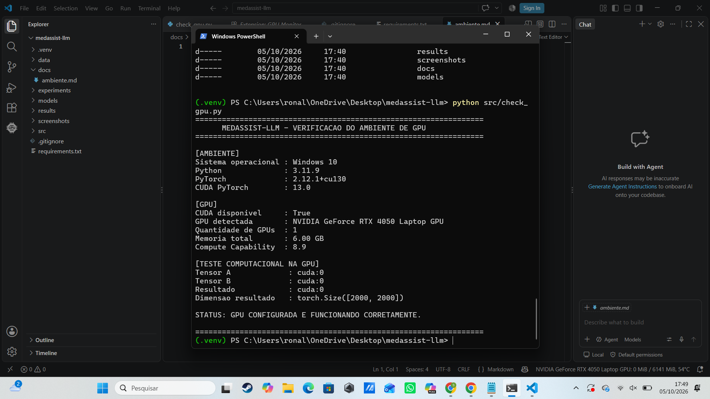
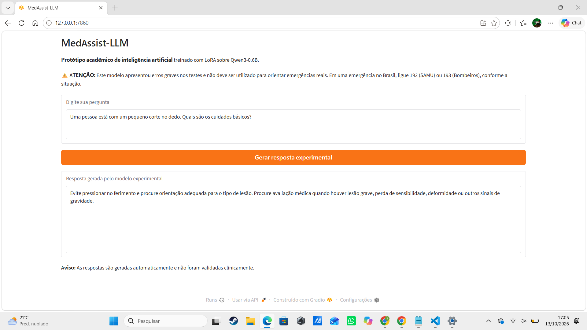

# MedAssist-LLM

## Fine-tuning local de uma LLM para primeiros socorros

Projeto acadêmico de inteligência artificial desenvolvido
para demonstrar o treinamento e a avaliação de um modelo
de linguagem utilizando GPU local.

O MedAssist-LLM utiliza o modelo Qwen3-0.6B, com
fine-tuning supervisionado (SFT) e adaptadores LoRA.

> AVISO: Este é um protótipo experimental acadêmico.
> Os modelos apresentaram erros graves durante os testes.
> Não utilize suas respostas para orientar emergências
> reais ou tomar decisões médicas.

## Objetivos

- Executar treinamento de uma LLM localmente.
- Utilizar GPU NVIDIA com CUDA.
- Aplicar fine-tuning supervisionado com LoRA.
- Comparar diferentes hiperparâmetros.
- Avaliar as respostas geradas.
- Desenvolver um frontend para interação.
- Documentar os resultados e as limitações.

## Tecnologias

- Python 3.11
- PyTorch e CUDA
- Hugging Face Transformers
- PEFT / LoRA
- TRL
- Gradio
- Visual Studio Code
- Git e GitHub

## Infraestrutura

GPU: NVIDIA GeForce RTX 4050 Laptop GPU

Modelo base:
https://huggingface.co/Qwen/Qwen3-0.6B

Evidência de execução na GPU:



## Datasets

| Versão | Treinamento | Validação |
|--------|-------------|-----------|
| V1 | 30 | 6 |
| V2 | 120 | 15 |

Foram utilizadas 10 perguntas para avaliação de
regressão dos experimentos.

Os dados foram preparados para fins acadêmicos.
O teste reutilizado na V2 não representa uma
avaliação final independente.

## Experimentos

Foram realizados seis treinamentos com diferentes
configurações de épocas, learning rate e LoRA.

| Experimento | Dataset | Épocas | Validation loss |
|-------------|---------|--------|-----------------|
| Exp01 | V1 | 1 | 2.3233 |
| Exp02 | V1 | 3 | 1.7720 |
| Exp03 | V1 | 3 | 1.8032 |
| Exp04 | V2 | 3 | 1.0683 |
| Exp05 | V2 | 5 | 1.1085 |
| Exp06 | V2 | 5 | 1.1795 |

As perdas de validação entre V1 e V2 não são
diretamente comparáveis, pois os conjuntos
de validação são diferentes.

O Exp04 foi selecionado como candidato para
demonstração por apresentar a menor validation
loss da V2 e menos falhas graves na avaliação
qualitativa preliminar.

Isso não significa que o modelo seja clinicamente seguro.

Detalhes completos:
[Relatório de experimentos](docs/experimentos.md)

Métricas:
[CSV de resultados](results/metrics_summary.csv)

## Frontend Gradio

Foi desenvolvida uma interface web local para
permitir que o usuário envie prompts e visualize
respostas geradas pelo modelo experimental.



### Como executar

O projeto foi desenvolvido no Windows com Python
3.11 e GPU NVIDIA compatível com CUDA.

1. Clone o repositório.
2. Crie um ambiente virtual Python.
3. Instale as dependências de requirements.txt.
4. Configure o PyTorch compatível com sua GPU e CUDA.
5. Disponibilize localmente os pesos do adaptador Exp04.
6. Execute:

```powershell
python app.py
```

A interface ficará disponível em:

http://127.0.0.1:7860

### Observação sobre os pesos

Os arquivos binários dos adaptadores LoRA não
foram incluídos no GitHub devido ao tamanho.

O repositório contém o código, as configurações,
os datasets, os resultados e a documentação.

Para executar a inferência, é necessário obter
separadamente os pesos do adaptador treinado.

## Avaliação e limitações

Os experimentos demonstraram a viabilidade
técnica do treinamento local com GPU.

Entretanto, a avaliação revelou falhas graves
em respostas sobre RCP, queimaduras, AVC,
convulsões, engasgo e intoxicações.

A avaliação foi exploratória e não substitui
validação clínica independente.

O sistema não deve ser utilizado em atendimentos
reais nem como ferramenta de suporte à decisão médica.

## Documentação

- [Ambiente e GPU](docs/ambiente.md)
- [Relatório dos experimentos](docs/experimentos.md)
- [Métricas dos treinamentos](results/metrics_summary.csv)

## Referências

- Qwen3-0.6B:
  https://huggingface.co/Qwen/Qwen3-0.6B

- Hugging Face Transformers:
  https://huggingface.co/docs/transformers

- Hugging Face PEFT:
  https://huggingface.co/docs/peft

- Hugging Face TRL:
  https://huggingface.co/docs/trl

- Gradio:
  https://www.gradio.app/

## Status

Protótipo acadêmico funcional, com treinamento
e inferência em GPU local, frontend Gradio e
avaliação documentada.

Não validado para uso clínico.
